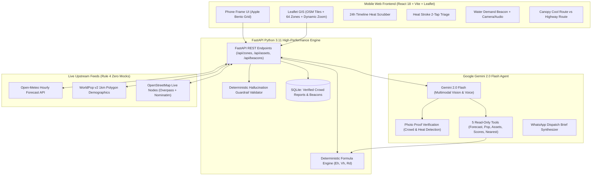

# HeatAtlas System Architecture (FORGE '26)

### Core Deterministic Mathematical Engine (Python)
- **Heat Exposure ($E_h$):** $\text{Population} \times H_{38}$
- **Vulnerable Person-Hours ($V_h$):** $(\text{Child Pop} + \text{Elderly Pop}) \times H_{38}$
- **Relief Deficit ($R_d$):** $\frac{V_h}{\text{Working Taps} + 2 \times \text{Clinics} + 1}$
- **Consensus Rule:** Taps marked dry when $\ge 2$ distinct session tokens report dry within 24h.
- **Multimodal AI Rule:** Gemini 2.0 Flash audits photos of stranded workers before broadcasting emergency beacons.
